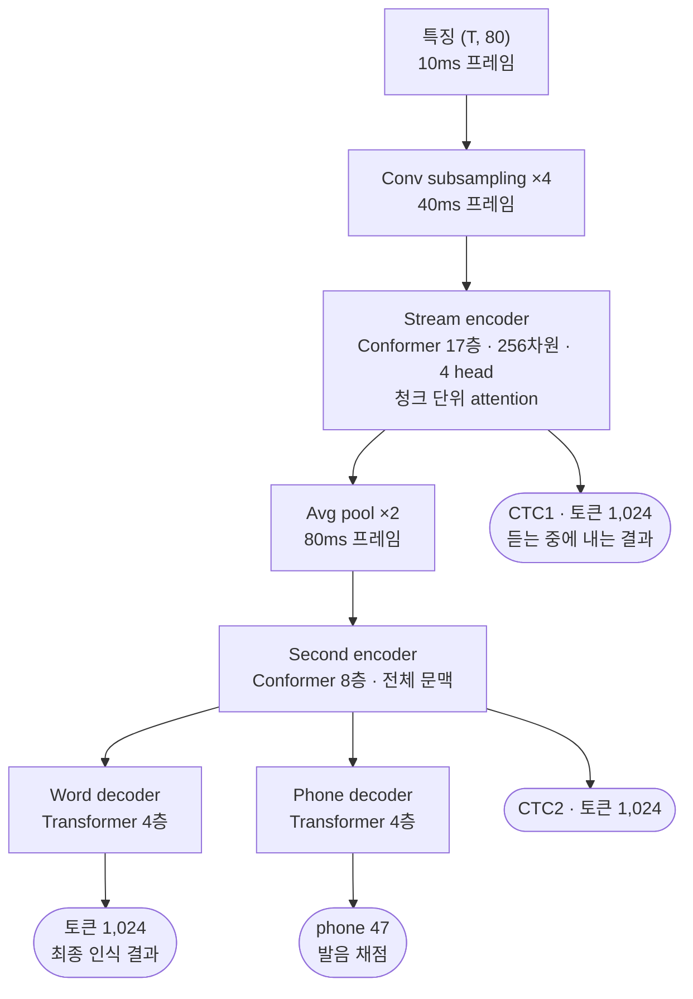

# 샘플 데이터로 학습하고 내보내기

저장소에 든 음성 100개로 레코드를 만들고, 학습하고, C++ 용으로 내보낸다. 명령은 `model/` 에서 실행한다.

```
data/sample (음성 + 전사) ──(1)──> data/sample/database (LMDB) ──(3)──> sample_model/asr_model.pt ──(4)──> sample_model_cpp_export/
```

음성 100개는 모델이 말을 알아듣게 되기에는 턱없이 적다. 학습부터 내보내기까지
처음부터 끝까지 돌아가는지 확인하는 용도다.

## 1. 레코드 만들기

```bash
./data/make_lmdb.sh
```

입력과 출력, 레코드 구조는 [data/README.md](data/README.md) 에 있다.

## 2. 모델

`AsrStreamConformer` — 청크 단위로 듣는 스트리밍 Conformer 다.
코드는 [app/asr_stream_conformer.py](app/asr_stream_conformer.py) 에 있다.



- **스트리밍**: stream encoder 는 청크 38프레임(1.52초) 안에서만 양방향으로 보고 미래 청크는 보지 않는다. 과거는 16청크까지 본다
- **출력**: CTC1 은 청크가 들어올 때마다 나온다. CTC2 와 두 decoder 는 발화가 끝난 뒤 한 번 계산한다
- **학습 손실**: CTC1, CTC2, 중간층 CTC(stream encoder 7번째 층), word CE, phone CE 다섯 개를 합친다

구조는 `config.json` 의 `model` 항목이 정한다.

```
"dim_model": 256, "enc_num_head": 4, "enc_num_layer": 17, "k_size": 15
"dec_hidden": 1024, "dec_num_head": 4, "dec_num_layer": 4
"vocab_size": 1024
"chunk_min": 38, "chunk_max": 38, "left_chunks": 16
"ctc_time_reduction": 2, "inter_ctc_layer": 6
```

## 3. 학습

```bash
./train.sh
```

GPU 가 필요하다. 샘플은 15초쯤 걸리고, 학습은 백그라운드로 돈다.

**설정** — `sample_model/config.json`

| 항목 | 값 | 뜻 |
|---|---|---|
| `train_record` | `data/sample/database` | 학습 레코드. 1 에서 만든 것 |
| `dev_record` | `data/sample/database` | 점검 레코드. 샘플이 적어 같은 것을 쓴다 |
| `lr` | 0.0001 | 학습률 |
| `max_epochs` | 3 | 에폭 수 |
| `max_feat_len` | 1600 | 16초보다 긴 발화는 뺀다 |

**진행 확인** — `sample_model/train.log`

```bash
tail -f sample_model/train.log
```

```
New model is generated!
==================== Epoch1 Train Loss: 155.44  =========================
===================== Epoch1 Test Loss: 114.88  ==========================
save: asr_model_20261117T00:17_epoch1_tr:155.441_dev:114.882.pt
...
==================== Epoch3 Train Loss: 78.05  =========================
===================== Epoch3 Test Loss: 65.28  ==========================
save: asr_model_20261117T00:17_epoch3_tr:78.047_dev:65.284.pt
```

손실이 에폭마다 줄어들면 정상이다.

**결과** — `sample_model/`

| 파일 | 내용 |
|---|---|
| `asr_model.pt` | 가장 최근 가중치. export 가 읽는 파일 |
| `asr_model_<시각>_epoch<N>_tr:<손실>_dev:<손실>.pt` | 에폭이 끝날 때마다 하나 |
| `asr_model0.pt`, `asr_model1.pt`, ... | 학습 중 돌려 쓰는 백업 |
| `train.log` | 학습 로그 |

**다른 모델 폴더로 학습**

```bash
MODEL_PATH=$PWD/my_model ./train.sh
```

`my_model/config.json` 이 있어야 한다. `sample_model/config.json` 을 복사해 고쳐 쓴다.

**알아둘 것**

- 모델 폴더에 `asr_model.pt` 가 있으면 그 가중치에서 이어서 학습한다. 처음부터 다시 하려면 `*.pt` 를 지운다
- 학습은 한 번에 하나만 돈다. 이미 돌고 있으면 "이미 실행 중" 이라고 알리고 끝난다
- 스크립트가 부르는 명령은 `python3 -u trainer/train_main.py sample_model --config_path sample_model/config.json` 이다

## 4. C++ 용으로 내보내기

```bash
./export.sh
```

C++ 엔진은 `asr_model.pt` 를 읽지 못한다. 텐서마다 파일 하나로 풀고, 엔진이 함께 읽는
사전과 목록을 같은 폴더에 모은다.

**입력** — `sample_model/config.json`, `sample_model/asr_model.pt`

**결과** — `sample_model_cpp_export/` (파일 1,090개, 209MB)

| 파일 | 내용 | 어디서 오나 |
|---|---|---|
| `*.pt` 1,082개 | 텐서 하나당 파일 하나. float32 숫자만 이어 쓴 파일이다 | `asr_model.pt` |
| `model.json` | 어떤 층이 어떤 파일을 쓰는지 적은 목록 | `config.json` 과 모델 |
| `mercury.model`, `mercury.vocab` | 토큰 사전 | `data/` |
| `full.dict` | 발음사전 | `data/` |
| `phone.txt`, `function_words.txt`, `proper_nouns.txt`, `ungraded_words.txt` | 발음 채점용 목록 | `../cpp/score/` |

```
[export.sh] 완료: .../sample_model_cpp_export (1090 개 파일, 209M)
```

**다른 모델 폴더나 다른 위치로**

```bash
MODEL_PATH=$PWD/my_model ./export.sh        # -> my_model_cpp_export/
EXPORT_PATH=/tmp/out ./export.sh            # -> /tmp/out/
```

`model.json` 에는 depthwise conv 의 `*_depthwise_bias.pt` 25개가 이름만 적혀 있고 파일은 없다.
이 conv 는 bias 를 쓰지 않아(`"bias": 0`) 엔진이 그 파일을 열지 않으니 정상이다.

**C++ 에서 쓰기** — 엔진에 이 폴더 경로를 넘긴다.

```cpp
MERCURY::AsrAPI asr_api("sample_model_cpp_export");
```
